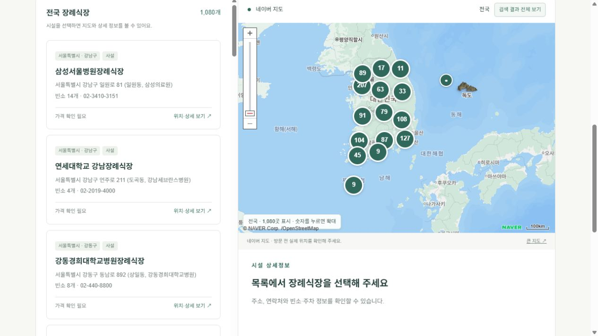

# 마음길 | 전국 장례식장 찾기

지역과 시설 정보를 한눈에 살펴보고, 가까운 장례식장의 위치와 연락처를 확인하는 웹 프로젝트입니다.

**[배포 사이트](https://maeum-gil-funeral-finder.vercel.app/)** · **[GitHub](https://github.com/luckyjookang/maeum-gil-funeral-finder)**



## 프로젝트 소개

장례식장을 찾을 때 필요한 지역, 주소, 연락처, 시설 정보를 한 화면에서 확인할 수 있도록 구성했습니다. 보건복지부 공공데이터 1,080건을 활용하고, 목록에서 시설을 선택하면 네이버 지도와 상세 정보가 함께 바뀌도록 구현했습니다.

- 데이터 기준: 2026.04.01
- 제공 범위: 전국 17개 시·도, 장례식장 1,080개
- 배포: Vercel Hobby · 정적 사이트
- 성격: 개인 학습 및 포트폴리오용 프로젝트

## 주요 기능

- **시설 검색**: 장례식장 이름, 동네, 주소로 실시간 목록 필터링
- **지역 필터**: 시·도와 시·군·구 선택, 지역별 시설 수 표시
- **운영 구분**: 공설·사설 조건을 지역 및 검색어와 함께 적용
- **전국·지역 지도**: 전국 1,080곳 또는 선택한 시·도·시·군·구의 시설을 함께 표시하고 전체 위치가 보이도록 지도 범위 조정
- **숫자 마커**: 가까운 장례식장을 숫자로 묶어 표시하고, 클릭하면 확대해 개별 시설 확인
- **확대 시 이름 표시**: 줌 레벨 14 이상에서는 초록색 아이콘 대신 시설명 이름표를 표시하고, 축소하면 아이콘으로 복귀
- **목록·지도 동기화**: 검색어·공설/사설 필터를 지도에도 적용하며, 시설 선택 후 ‘검색 결과 전체 보기’로 전체 범위 복귀
- **시설 상세**: 빈소 수, 주차 가능 대수, 안치 가능 수, 전화번호, 홈페이지 확인
- **외부 연결**: 전화 걸기, 네이버 지도 검색, 길찾기를 위한 외부 지도 연결
- **목록 내려받기**: 전체 시설 CSV 다운로드
- **반응형 화면**: 데스크톱에서는 목록과 지도를 나란히, 모바일에서는 세로 배치

## 기술 구성

| 구분 | 사용 기술 |
| --- | --- |
| 화면 | HTML5, CSS3 · Grid, Flexbox, 미디어 쿼리 |
| 동작 | Vanilla JavaScript · DOM API, Fetch API |
| 지도 | NAVER Maps JavaScript API v3 · Dynamic Map, Geocoding |
| 데이터 | 정적 JSON, CSV |
| 호스팅 | Vercel |

프레임워크나 별도의 서버 없이 브라우저에서 데이터를 불러오고 검색·필터·상세 화면을 처리합니다. 현재 구현에는 데이터베이스, 로그인, 예약 기능이 없습니다.

## 구현에서 고려한 점

### 목록과 지도 연결

네이버 Geocoding으로 1,080개 시설 주소의 좌표를 미리 준비하고 `facility-coordinates.json`에 저장했습니다. 방문 시에는 저장된 좌표를 사용해 지역 및 검색 조건에 해당하는 시설 전체를 표시합니다. 목록의 ‘더 보기’와 관계없이 지도에는 전체 검색 결과가 포함됩니다. 시설 하나를 선택하면 해당 위치로 이동하며, 지역을 바꾸면 이전 지역 마커를 제거하고 지도 범위를 새 결과에 맞춥니다.

줌 레벨별 화면 격자를 기준으로 가까운 시설을 숫자 마커로 묶습니다. 숫자는 포함된 시설 수이며, 확대하면 개별 위치로 나뉩니다. 같은 좌표의 시설은 확대 후 숫자 마커에서 시설 목록을 열어 선택할 수 있습니다.

### 지도 로딩과 오류 처리

지도 스크립트가 준비된 뒤 지도를 초기화합니다. 지도를 숨겼다가 다시 표시할 때는 크기를 갱신해 일부 영역이 비어 보이는 문제를 보완했습니다. 좌표가 누락되면 표시 개수와 미확인 개수를 구분하며, 검색 결과가 없으면 마커를 모두 지웁니다. 지도 인증이 실패하면 네이버 지도 검색 링크를 제공합니다.

### 검색 결과 렌더링

여러 필터를 함께 적용하고, 결과를 30개씩 표시해 초기 DOM 생성을 줄였습니다. 동적으로 HTML에 넣는 시설 정보는 특수 문자를 이스케이프하며, 홈페이지 링크는 HTTP·HTTPS 형식만 허용합니다.

### 확인되지 않은 정보 표시

공공데이터에 없는 가격을 임의로 제시하지 않고 ‘확인 필요’로 표시합니다. 빈소·주차·안치 수 등 누락된 값은 ‘미기재’로 구분합니다.

## 로컬 실행

Node.js와 npm이 설치된 환경에서 실행합니다. 별도의 빌드는 필요하지 않습니다.

```bash
git clone https://github.com/luckyjookang/maeum-gil-funeral-finder.git
cd maeum-gil-funeral-finder
npx --yes serve dist -l 3000
```

브라우저에서 `http://localhost:3000`에 접속합니다. JSON을 Fetch API로 불러오므로 HTML 파일을 직접 여는 `file://` 방식 대신 HTTP 서버를 사용합니다.

## 네이버 지도 설정

다른 도메인이나 로컬 환경에서 지도를 사용하려면 본인의 네이버 클라우드 Maps 애플리케이션을 설정합니다.

1. Maps 애플리케이션에서 **Dynamic Map**을 선택합니다. 좌표 데이터를 새로 준비할 때는 **Geocoding**도 필요합니다.
2. Web 서비스 URL에 배포 도메인을 등록합니다. 로컬 확인용으로는 `http://localhost`를 등록합니다.
3. `dist/map-config.js`의 공개 Client ID를 본인의 값으로 바꿉니다.

```javascript
window.MAEUM_MAP_CONFIG = { clientId: "YOUR_NCP_KEY_ID" };
```

Client ID는 브라우저에서 사용하는 공개 식별자입니다. **Client Secret은 프런트엔드나 저장소에 넣지 않습니다.** 이 저장소에 포함된 배포용 Client ID는 등록된 서비스 도메인에 맞춰 사용합니다. 지도 API의 무료 이용량과 과금 조건은 호스팅 요금과 별도입니다.

## Vercel 배포

현재 사이트는 `dist` 폴더를 Vercel Drop으로 업로드해 배포했습니다. 저장소를 Vercel에 연결하는 경우 아래 설정을 사용합니다.

| 항목 | 값 |
| --- | --- |
| Framework Preset | Other |
| Build Command | 없음 |
| Output Directory | `dist` |

루트의 `vercel.json`에 정적 배포 설정이 포함되어 있습니다. 새 배포 도메인을 네이버 클라우드 Web 서비스 URL에 추가해야 지도 인증이 정상 동작합니다. GitHub 저장소 생성만으로 기존 Vercel 프로젝트의 자동 배포가 연결되지는 않습니다.

## 폴더 구조

```text
.
├── README.md
├── vercel.json
├── docs/
│   └── screenshot.png
└── dist/
    ├── index.html       # 화면 구조
    ├── style.css        # 스타일 및 반응형 레이아웃
    ├── app.js           # 검색, 필터, 상세 정보, 지도 연동
    ├── map-model.js     # 좌표 검증 및 숫자 마커 그룹 계산
    ├── map-config.js    # 네이버 지도 공개 Client ID
    ├── facility-coordinates.json # 미리 확인한 1,080개 주소 좌표
    ├── facilities.json  # 화면에서 사용하는 시설 데이터
    └── facilities.csv   # 다운로드용 전체 목록
```

## 확인한 동작

- Vercel 프로덕션 배포 완료 및 페이지 접속
- 1,080개 시설 목록 로딩
- 전국 1,080곳·서울 61곳·부산 55곳의 지도 표시 개수 일치
- 숫자 마커 클릭 확대, 지역 전환, 시설 선택과 전체 범위 복귀
- 검색 결과가 없는 경우 지도 마커 제거

좌표 유효성, 지역 전환, 줌별 시설 개수 보존, 같은 좌표의 시설 처리, 잘못된 좌표 제외를 검증하는 Node.js 테스트 5개를 포함했습니다.

```bash
node --test tests/map-model.test.cjs
```

## 현재 한계와 개선 방향

- 시설 데이터는 정적 스냅샷이며 운영 여부·빈소 이용 가능 여부를 실시간으로 반영하지 않습니다.
- 가격 조회나 실제 예약을 제공하지 않습니다. 최종 정보는 시설에 직접 확인해야 합니다.
- ‘내 주변 찾기’는 네이버 지도의 외부 검색 링크이며 현재 위치를 직접 수집하지 않습니다.
- 저장된 좌표는 주소 기반 Geocoding 결과이며 실제 시설 입구와 위치가 다를 수 있습니다. 좌표 준비일은 `facility-coordinates.json`의 `generatedAt`에서 확인할 수 있습니다. 시설 데이터가 바뀌면 좌표도 함께 갱신해야 합니다.
- 향후 데이터 갱신 절차, 주소 정규화, 필터 조합 테스트, 키보드·스크린리더 검증을 보완할 수 있습니다.

## 데이터 출처

- [공공데이터포털 — 보건복지부 장례식장 현황](https://www.data.go.kr/data/15143467/fileData.do)
- [네이버 지도 API 문서](https://navermaps.github.io/maps.js.ncp/docs/)
- [e하늘 장사정보](https://www.15774129.go.kr/)

공공데이터 및 지도 서비스의 이용 조건과 출처 표기를 따릅니다. 이 저장소에는 별도의 오픈소스 라이선스를 지정하지 않았습니다.
